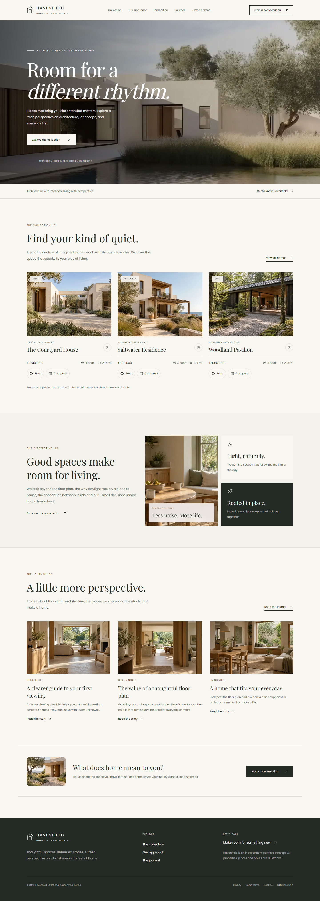

# Havenfield

My live portfolio is at [havenfield-portfolio.vercel.app](https://havenfield-portfolio.vercel.app).

I built Havenfield as an independent real estate portfolio: a fictional property collection, original architectural imagery, and an editorial studio for publishing stories about homes and design. I rebuilt the site with Next.js, React, strict TypeScript, and Tailwind CSS, with TypeScript REST endpoints and relational persistence.



The application includes shareable property search/filtering, keyboard galleries, a consented demo inquiry workflow, and a journal. My authenticated editorial studio supports draft/published/scheduled articles, interrupted-writing recovery, safe Markdown previews, a reusable media library with reference protection, SEO metadata, normalized categories/tags, revisions/restoration, slug redirects, private previews, and deletion. I can review, archive and delete inquiries, inspect publisher actions, and export a checksummed database-and-image recovery bundle. Public RSS, sitemap and article structured data follow publication visibility.

All brand copy, property data, article text, logos, and media are newly created. I retained the existing local Playfair Display and Poppins font files with their license notices. The hero film is new AI-generated architectural footage made with Higgsfield/Hailuo, optimized to a silent six-second landscape clip. Legacy HTML, PHP, Composer packages and stylesheets are removed.

## Run locally

Use Node.js 24:

```powershell
npm.cmd ci
npm.cmd run db:migrate
npm.cmd run db:seed
npm.cmd run dev
```

Open `http://localhost:3000`. Without a PostgreSQL URL, local development uses an ignored SQLite database. The seed preserves existing edited articles.

For editorial access, copy `.env.example` to `.env.local`, set `ADMIN_EMAIL`, and run `npm.cmd run admin:password` to generate a private password hash and session secret. Restart the server and open `/admin/login`. I do not ship default admin credentials.

## Validate and deploy

```powershell
npm.cmd run check
npm.cmd run test:postgres
npm.cmd run test:e2e
```

Local browser checks use installed Edge, temporary synthetic credentials, and isolated databases/uploads that the runner cleans up. I deployed the application to Vercel with separate Production/Preview Prisma Postgres databases and Vercel Blob stores in Singapore. Both hosted environments passed publishing, media, inquiry, session, responsive-layout and CSP checks; the [deployment record](development-plans/deployment.md) includes the exact deployment and source manifest. Prisma's free allowance remains finite. I published this project to [GitHub](https://github.com/asteroidcrib729/havenfield-next-web-app) with passing clean-checkout CI and connected the existing Vercel project. Pushing to `main` now automatically deploys Production; other branches use Preview. Independent scheduled backups, hosted recovery and human accessibility/performance acceptance remain open release gates.

I keep all plans, progress, production instructions and asset records under [development-plans](development-plans/). Only this README belongs at the root as authored Markdown.

- [Development plan 01](development-plans/development-plans-01.md)
- [Development plan 02: product completion](development-plans/development-plan-02.md)
- [Plan 02 execution record](development-plans/development-plan-02-progress.md)
- [Database migrations and recovery](development-plans/database-recovery.md)
- [Generated hero footage and credit record](development-plans/hero-video-generation.md)
- [Implementation and validation](development-plans/implementation.md)
- [Cleanup record](development-plans/cleanup.md)
- [Brand and asset register](development-plans/brand-and-assets.md)
- [Database comparison](development-plans/database-options.md)
- [Vercel setup and editorial operations](development-plans/deployment.md)
- [Environment matrix and operator guide](development-plans/operator-guide.md)
- [Release acceptance and remaining external gates](development-plans/release-acceptance.md)
- [Performance and quota measurements](development-plans/performance-and-quotas.md)
- [Release notes](development-plans/release-notes.md)
- [GitHub publication and automatic Vercel deployments](development-plans/github-publication.md)
- [Shared Prisma project and Preview database consolidation](development-plans/prisma-project-consolidation.md)

I license the application source under [MIT](LICENSE). Font licenses and generated-media provenance are recorded separately in the asset register.

This is a portfolio demonstration. Properties, places and guide prices are illustrative; inquiries are stored as demo receipts without sending mail or arranging viewings.
